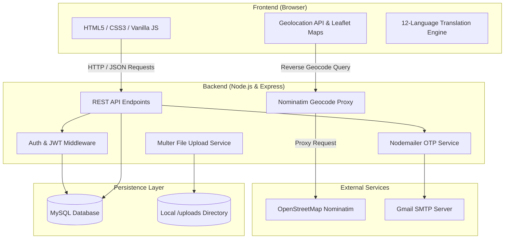
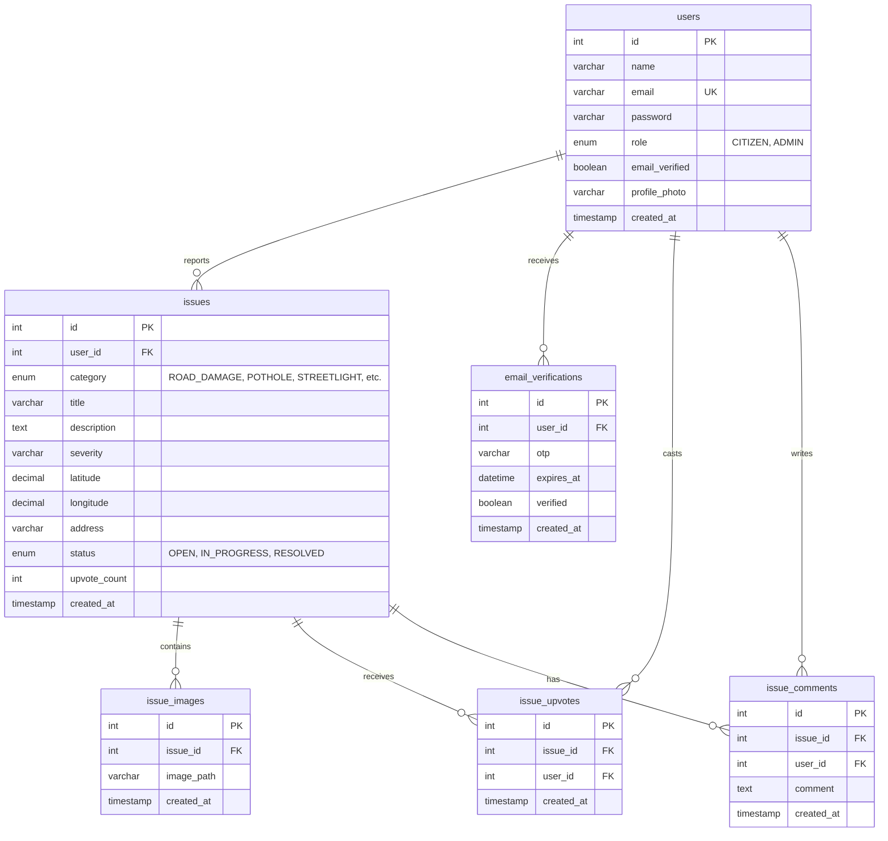

# CivicFix 🚦🛠️
> **Smart Civic Issue & Road Hazard Tracker**  
> A full-stack citizen portal and administrative management system for reporting, geotagging, upvoting, and resolving civic problems in real time.

---

## 📌 Table of Contents
- [Overview](#-overview)
- [Key Features](#-key-features)
- [System Architecture](#-system-architecture)
- [Database Schema & ER Diagram](#-database-schema--er-diagram)
- [Tech Stack](#-tech-stack)
- [Project Structure](#-project-structure)
- [Getting Started](#-getting-started)
  - [Prerequisites](#prerequisites)
  - [1. Clone / Navigate](#1-clone--navigate)
  - [2. Database Setup](#2-database-setup)
  - [3. Configure Environment Variables](#3-configure-environment-variables)
  - [4. Install Dependencies](#4-install-dependencies)
  - [5. Run the Application](#5-run-the-application)
- [Default Demo Credentials](#-default-demo-credentials)
- [API Reference](#-api-reference)
- [Future Roadmap](#-future-roadmap)

---

## 📖 Overview

Municipalities often face delayed issue resolution because citizen complaints lack precise geographical coordinates, visual proof, or a mechanism to prioritize recurring hazards.

**CivicFix** bridges the gap between citizens and municipal authorities:
- **Citizens** can capture photos of civic problems (potholes, garbage, water leaks, streetlights), automatically detect their geolocation via GPS / reverse geocoding, and track resolution status.
- **Community Engagement** allows citizens to upvote pressing local issues and post comments. Duplicate reports within 50 meters are automatically detected.
- **Administrators & Ward Officers** access a dedicated management dashboard with live metrics (`OPEN`, `IN_PROGRESS`, `RESOLVED`) to triage and update complaints.
- **Accessibility** is built-in with full multilingual translation across 12 Indian regional languages.

---

## ✨ Key Features

| Category | Features |
| :--- | :--- |
| **📍 Geotagging & Mapping** | Automatic browser geolocation detection, reverse geocoding with OpenStreetMap Nominatim, manual address search proxy, and Leaflet interactive map integration. |
| **🛡️ Smarter Duplicate Confirmation** | Detects existing reports within a 50-meter radius and opens a confirmation modal: allows the citizen to upvote the existing report to boost visibility or proceed with a separate submission. |
| **📸 Camera Capture & Watermarking** | Direct in-browser device camera streaming with switchable front/back cameras. Automatically stamps real-time GPS coordinates, reverse-geocoded address, and timestamps directly onto photo evidence via HTML5 Canvas. |
| **📱 Progressive Web App (PWA)** | Installable web application with `manifest.json`, responsive SVG/PNG icons, and offline caching via Service Worker (`sw.js`). |
| **🌓 Dark Mode & Skeleton Loaders** | Full light/dark mode theme toggle with zero-flicker initialization, system theme detection, and smooth animated shimmer skeleton loaders while fetching issue cards. |
| **💬 Citizen Engagement** | One-click issue upvoting to elevate priority, plus a real-time commenting thread per issue. |
| **🌐 Multilingual Support** | Instant client-side translation across 12 Indian languages: English, हिन्दी, ಕನ್ನಡ, தமிழ், తెలుగు, বাংলা, मराठी, ગુજરાતી, ਪੰਜਾਬੀ, മലയാളം, اردو, and ଓଡ଼ିଆ. |
| **🔐 Secure Authentication** | Password hashing with `bcryptjs`, JWT session tokens, 6-digit email OTP verification, and secure password reset flow via Nodemailer. |
| **📊 Admin Control Room** | Issue triage panel displaying status metrics, category filters, and quick status workflow toggles (`OPEN` ➔ `IN_PROGRESS` ➔ `RESOLVED`). |

---

## 🏛️ System Architecture



---

## 🗄️ Database Schema & ER Diagram

CivicFix is powered by a relational MySQL database with foreign key constraints and cascade rules.



---

## 💻 Tech Stack

- **Backend Runtime**: [Node.js](https://nodejs.org/) (v18+)
- **Web Framework**: [Express.js](https://expressjs.com/) (v5)
- **Database**: [MySQL](https://www.mysql.com/) (with `mysql2` connection pooling)
- **Authentication**: [JSON Web Tokens (JWT)](https://jwt.io/) & [bcryptjs](https://github.com/dcodeIO/bcrypt.js)
- **File Handling**: [Multer](https://github.com/expressjs/multer)
- **Email & OTP**: [Nodemailer](https://nodemailer.com/) (SMTP)
- **Mapping & GIS**: [Leaflet.js](https://leafletjs.com/) & [OpenStreetMap Nominatim](https://nominatim.openstreetmap.org/)
- **Frontend**: HTML5, Modern CSS (Custom Properties / Flexbox / Grid), Vanilla JavaScript

---

## 📁 Project Structure

```text
mini project/
├── .env.example            # Environment variables template
├── .gitignore              # Git ignore rules (node_modules, .env, uploads)
├── db.js                   # MySQL connection pool configuration
├── package.json            # Project dependencies & scripts
├── schema.sql              # Database schema & initial seed data
├── server.js               # Express application entry point & API routes
│
├── public/                 # Static frontend assets
│   ├── index.html          # Citizen login & registration portal
│   ├── app.js              # Authentication logic & OTP handlers
│   ├── dashboard.html      # Citizen dashboard (report issue form)
│   ├── dashboard.js        # Geolocation, camera, & issue submission
│   ├── issues.html         # Community issues feed & interactive map
│   ├── issue.html          # Individual issue details, upvotes, & comments
│   ├── issue.js            # Upvote & comment management
│   ├── my-reports.html     # Citizen's personal reported issues
│   ├── my-reports.js       # Edit & delete own reports
│   ├── admin-login.html    # Dedicated administrator login portal
│   ├── admin.html          # Municipal admin triage & status dashboard
│   ├── admin.js            # Status updates & statistics visualization
│   ├── language.js         # 12-language Indian translation engine
│   └── style.css           # Global stylesheet & design system
│
└── uploads/                # Directory for user-submitted issue & profile photos
```

---

## 🚀 Getting Started

### Prerequisites
- [Node.js](https://nodejs.org/) (v18.x or later installed)
- [MySQL Server](https://dev.mysql.com/downloads/mysql/) or [XAMPP](https://www.apachefriends.org/) running locally

---

### 1. Clone / Navigate
Open your terminal in the project directory:
```bash
cd "C:\project\mini project"
```

### 2. Database Setup
Create and initialize the database using the provided `schema.sql`:

**Via MySQL CLI:**
```bash
mysql -u root -p < schema.sql
```
*Or via phpMyAdmin / MySQL Workbench: Open `schema.sql`, copy its contents, and execute.*

This script automatically creates the `civicfix` database, all 6 tables, foreign key constraints, indexes, and initial demo accounts.

---

### 3. Configure Environment Variables
Copy `.env.example` to `.env`:
```bash
cp .env.example .env
```
Open `.env` and verify your configuration:
```env
DB_HOST=localhost
DB_USER=root
DB_PASSWORD=your_mysql_password
DB_NAME=civicfix
PORT=3000
JWT_SECRET=your_jwt_secret_key
EMAIL_USER=your_email@gmail.com
EMAIL_PASSWORD=your_gmail_app_password
```

---

### 4. Install Dependencies
```bash
npm install
```

---

### 5. Run the Application

**Development mode (auto-reload on save):**
```bash
npm run dev
```

**Production mode:**
```bash
npm start
```

Once running, access the application in your browser:
- **Citizen Portal**: [http://localhost:3000](http://localhost:3000)
- **Admin Portal**: [http://localhost:3000/admin-login.html](http://localhost:3000/admin-login.html)
- **Community Issues Feed**: [http://localhost:3000/issues.html](http://localhost:3000/issues.html)

---

## 🔑 Default Demo Credentials

The database seed provides two ready-to-use accounts:

| Role | Email | Password | Access URL |
| :--- | :--- | :--- | :--- |
| **Municipal Admin** | `admin@civicfix.com` | `Admin@123` | `/admin-login.html` |
| **Citizen** | `citizen@civicfix.com` | `Citizen@123` | `/` |

---

## 📡 API Reference

### 🔐 Authentication & Profile
| Method | Endpoint | Auth | Description |
| :--- | :--- | :---: | :--- |
| `POST` | `/api/register` | No | Register a new citizen account |
| `POST` | `/api/send-otp` | No | Dispatch 6-digit email OTP for verification |
| `POST` | `/api/verify-email` | No | Validate OTP and activate user account |
| `POST` | `/api/login` | No | Authenticate user and receive JWT token |
| `POST` | `/api/forgot-password`| No | Dispatch OTP to reset forgotten password |
| `POST` | `/api/reset-password` | No | Verify reset OTP and update password |
| `PUT` | `/api/profile` | Yes | Update citizen profile name and avatar |

### 🛠️ Civic Issues
| Method | Endpoint | Auth | Description |
| :--- | :--- | :---: | :--- |
| `GET` | `/api/issues` | No | Fetch all public issues (supports `?category=` and `?status=`) |
| `GET` | `/api/issues/:id` | No | Fetch complete details for a single issue |
| `GET` | `/api/my-issues` | Yes | Retrieve all issues submitted by the logged-in citizen |
| `POST` | `/api/issues` | Yes | Submit a new issue with coordinates and photo |
| `PUT` | `/api/issues/:id` | Yes | Update own reported issue details |
| `DELETE` | `/api/issues/:id` | Yes | Delete an issue owned by the logged-in citizen |

### 👍 Upvotes & 💬 Comments
| Method | Endpoint | Auth | Description |
| :--- | :--- | :---: | :--- |
| `POST` | `/api/issues/:id/upvote` | Yes | Toggle upvote for an issue |
| `GET` | `/api/issues/:id/upvote-status` | Yes | Check if logged-in user upvoted an issue |
| `GET` | `/api/issues/:issueId/comments` | No | List all comments on an issue |
| `POST` | `/api/issues/:issueId/comments` | Yes | Add a new comment to an issue |
| `DELETE`| `/api/issues/:issueId/comments/:commentId` | Yes | Delete a comment (by author or issue owner) |

### 🧭 Geocoding & Proxies
| Method | Endpoint | Auth | Description |
| :--- | :--- | :---: | :--- |
| `GET` | `/api/reverse-geocode` | No | Convert `lat` & `lon` into a formatted street address |
| `GET` | `/api/geocode/search` | No | Progressive geocoding search for street/area names |

### 👑 Admin Management
| Method | Endpoint | Auth | Description |
| :--- | :--- | :---: | :--- |
| `GET` | `/api/admin/stats` | Admin | Retrieve counts of `OPEN`, `IN_PROGRESS`, `RESOLVED` |
| `PUT` | `/api/admin/issues/:id/status` | Admin | Update issue workflow status (`OPEN`/`IN_PROGRESS`/`RESOLVED`) |

---

## 🔮 Future Roadmap

- [ ] **AI-Powered Image Verification**: Automatically validate uploaded photos (detect potholes, garbage, or road hazards) before submission to prevent spam.
- [ ] **Proof of Resolution**: Require municipal officers to upload a "Fixed / After" photo before marking an issue `RESOLVED`.
- [ ] **Departmental Routing**: Automatic routing of complaints to specific municipal departments (PWD, BWSSB, BESCOM, Solid Waste).
- [ ] **Exportable Analytics**: Download monthly ward-level complaint & resolution summaries in PDF or Excel format.
- [ ] **PWA & Offline Mode**: Installable mobile web app with offline draft caching and native camera capture.

---

## 📄 License
This project is developed as an academic mini-project for educational and community benefit.
